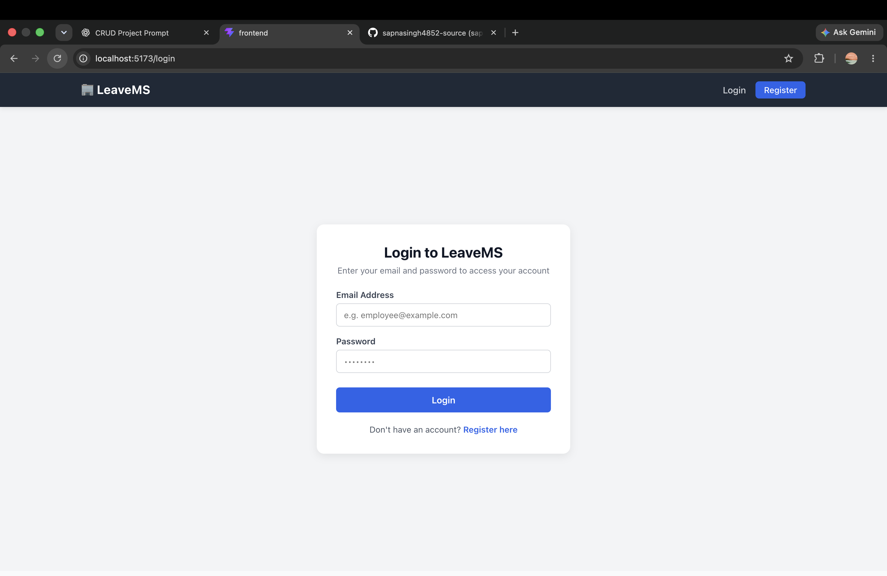
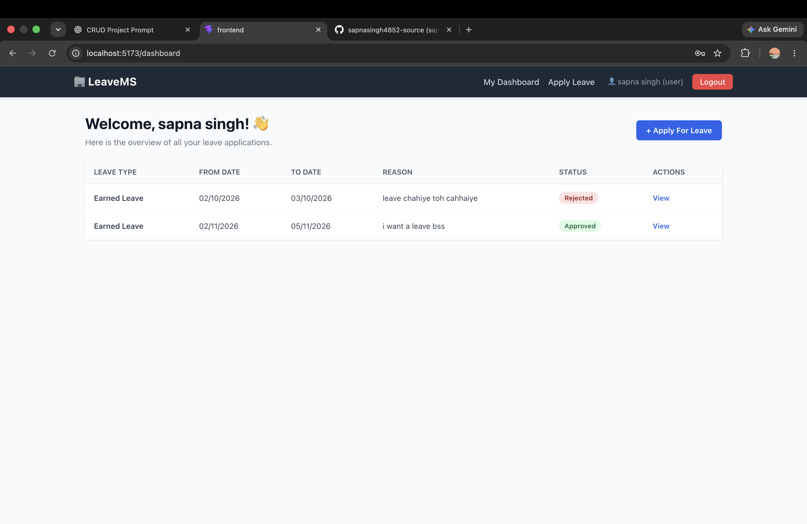
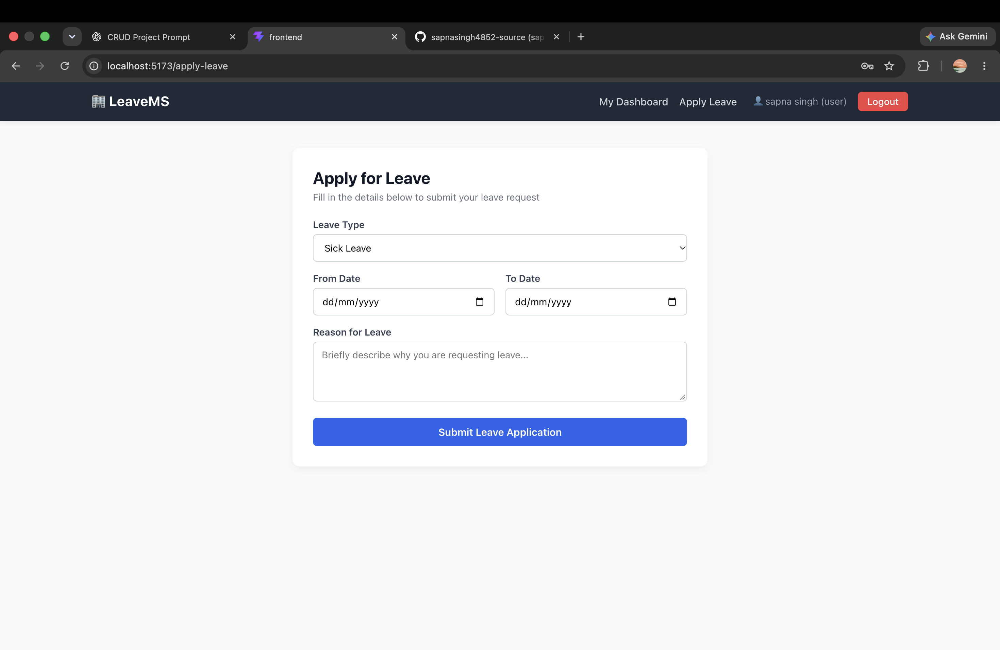
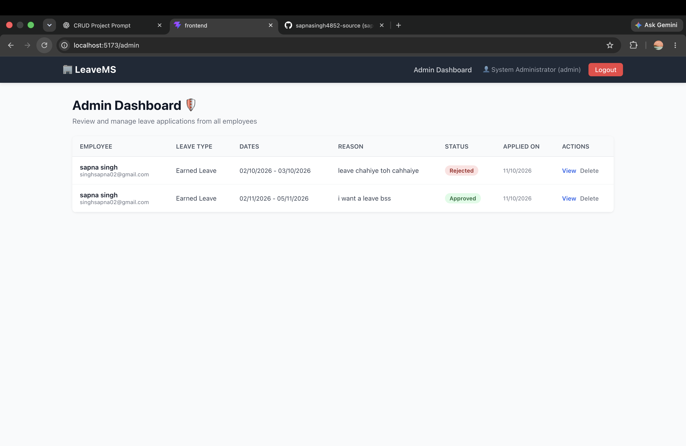

# Leave Management System

A beginner-friendly Full-Stack Leave Management System built using the MERN stack (MongoDB, Express, React, Node.js). It enables employees to apply for and track leave requests, while allowing administrators to review, approve, or reject them.

---

## Deployment Links

- **Frontend:** `[Will be added after deployment]`
- **Backend:** `[Will be added after deployment]`

---

## Project Description

The Leave Management System simplifies and automates the leave application process in an organization. Employees can register, log in, submit leave requests with specific dates and reasons, and check the status of their applications. Administrators can view all employee leave requests, see employee details, and approve or reject applications in real time.

---

## Features

### User / Employee
- Register and Login (JWT Authentication)
- Apply for leave (Sick, Casual, Earned, Emergency, Other)
- View own leave applications and live status (Pending, Approved, Rejected)
- View individual leave details
- Edit own leave while status is Pending
- Delete/cancel own leave while status is Pending

### Admin
- Admin Login
- View all employee leave applications
- View individual leave details along with employee info
- Approve leave applications
- Reject leave applications
- Delete leave records

---

## Tech Stack

- **Frontend:** React.js, Vite, React Router, CSS
- **Backend:** Node.js, Express.js
- **Database:** MongoDB, Mongoose
- **Authentication:** JWT (JSON Web Token), bcryptjs
- **Others:** CORS, dotenv

---

## Team Members

| Name | Role | Responsibilities |
|---|---|---|
| Sapna Singh | Team Lead | Full-Stack Architecture, Backend APIs, Review |
| Purnima Raj| Frontend Developer | UI Design, React Components |


---

## API Endpoints

### Authentication
- `POST /api/auth/register` - Register a new employee (Public)
- `POST /api/auth/login` - Login user/admin and get JWT token (Public)

### Leaves
- `POST /api/leaves` - Apply for leave (Authenticated User)
- `GET /api/leaves` - Get leave applications (User: own leaves, Admin: all leaves)
- `GET /api/leaves/:id` - View single leave details (User: own, Admin: any)
- `PUT /api/leaves/:id` - Edit leave (User: own while Pending, Admin)
- `DELETE /api/leaves/:id` - Delete leave (User: own while Pending, Admin)
- `PATCH /api/leaves/:id/approve` - Approve leave (Admin only)
- `PATCH /api/leaves/:id/reject` - Reject leave (Admin only)

---

## Environment Variables

### Backend (`backend/.env`)
```env
PORT=5001
MONGO_URI=mongodb://127.0.0.1:27017/leave_management
JWT_SECRET=my_super_secret_jwt_key_12345
```

### Frontend (`frontend/.env`)
```env
VITE_API_URL=http://localhost:5001/api
```

---

## Setup Instructions

### 1. Prerequisites
- Node.js (v18+)
- MongoDB running locally or MongoDB Atlas connection URI

### 2. Backend Setup
```bash
cd backend
npm install
cp .env.example .env
npm run seed:admin   # Creates default admin: admin@example.com / admin123
npm run dev
```
Backend runs on: `http://localhost:5001`

### 3. Frontend Setup
```bash
cd frontend
npm install
cp .env.example .env
npm run dev
```
Frontend runs on: `http://localhost:5173`

---

## Screenshots

### 1. Login Page


### 2. User Dashboard


### 3. Apply Leave Form


### 4. Admin Dashboard

